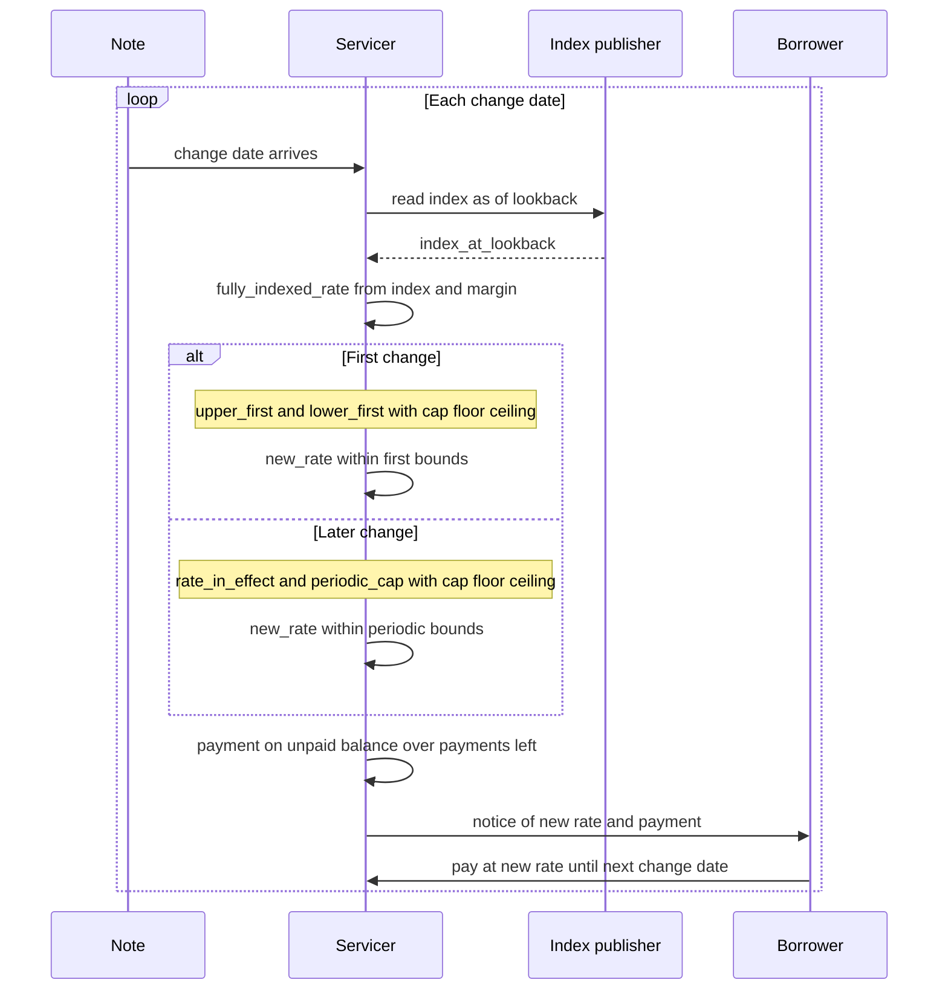

# ARM loan concepts

This skill explains adjustable-rate mortgage types and how a fixed-then-adjusting adjustable-rate mortgage changes its note rate at scheduled change dates and how the servicer sets the payment afterward. It is for concept questions: what the terms mean and how the steps fit together. It does not compute a payment, an interest total, a reset rate for anyone's loan, or an index value, and it does not run any script. Dollar figures appear only as labeled illustrations in Types.

## Types

An adjustable-rate mortgage has one value on each of two independent axes: the rate schedule and the payment structure. The adjustment procedure later in this skill is the fully amortizing one. Interest-only and option loans are explained here and are not calculated. Dollar figures in this section are labeled illustrations. They are the page's general scenario and one CFPB sample. They are not a reader's loan.

The page's general scenario is a purchase price of $600,000 with 5% down, so the loan is $570,000, at a note rate of 7.375% for 30 years. Its heading shows $4,853, the prevailing monthly total. Principal and interest on the fully amortizing loan is $3,936.85. The property-tax note on that scenario is Nashua at 1.683% and Brentwood at 1.32%. Those are local tax rates on the purchase price, not a note rate, an index, or a cap.

**Axis A, rate schedule.**

A **Traditional ARM** uses the same length for every adjustment period, including the first. A 1/1 ARM is set for 1 year, then resets every year. The first period is the first adjustment period, not a special fixed period. The first change is still the payment after that first period, and the initial cap and the initial floor still bound it. Later changes still use the periodic cap.

A **Hybrid ARM** has an initial rate period longer than the later adjustment periods. It behaves like a fixed-rate loan during the initial period and like an adjustable loan after that. A 5/1, a 7/1, and a 10/1 keep the start rate for 5, 7, or 10 years, then adjust every year. A 5/6m and a 7/6m keep the start rate for 5 or 7 years, then adjust every six months. The page's structure label writes a six-month interval without the m, so a 7-year, six-month hybrid is labeled 7/6.

Page illustration of a hybrid, not a reader's loan: the general scenario above, with an initial period of 7 years and an adjustment every 12 months, is a 7/1 hybrid with caps of 5/2/5. Those caps are an initial cap of 5 points, a periodic cap of 2 points, and a lifetime cap of 5 points. The lifetime cap is relative to the initial rate, so the ceiling is 7.375% + 5 points = 12.375%. The page's margin and lifetime floor on that ARM are both 2.5%, so the floor equals the margin. With no index, the page's fully amortizing illustration reaches that ceiling at payment 85, and the highest principal and interest is $5,725.59. When the start month is October 2026, the page labels payment 85 as November 2033. This skill does not compute that date for any other start month, and it does not compute the payment.

**Axis B, payment structure.**

**Fully amortizing.** Each payment covers that month's interest plus principal and is sized to pay the loan off by the end of the term. At a rate change the payment is recalculated over the remaining term, which is the payment step in the procedure below. On the general scenario, that principal and interest is $3,936.85. Month 1 of it is $3,503.13 of interest and $433.72 of principal, so the balance falls. That is positive amortization.

**Interest-only.** During the interest-only period the payment is only the interest, the balance times the annual rate divided by 12, so the balance does not fall. That is zero amortization. After the interest-only period the payment jumps, because principal is then repaid over the shorter remaining term. This skill does not compute that later payment.

Page illustration: $570,000 at 7.375% interest-only is 570000 × 0.07375 / 12 = $3,503.13 a month. The exact quotient is 3503.125, rounded half up to the cent. Set next to the fully amortizing $3,936.85, the interest-only payment matches month 1's interest and leaves out the $433.72 of principal, so the balance stays $570,000. The page does not offer this payment, and this skill does not walk it.

CFPB sample illustration, secondary to the page scenario: $211,000 at 4% interest-only is 211000 × 0.04 / 12 = $703.33 a month. That sample is a hybrid interest-only 5/3 ARM, an initial period of 5 years, then an adjustment every 3 years, with an interest-only payment. It is the CFPB's illustration in the Consumer Handbook on Adjustable-Rate Mortgages (CHARM booklet), not a loan this skill calculates.

**Option ARM.** The borrower picks each month among a minimum payment, an interest-only payment, or a fully amortizing payment. The minimum can be below the interest due. The unpaid interest is added to the balance, which is negative amortization. Option ARMs (payment-option ARMs) largely left the US market after 2008 and the Qualified Mortgage rules. This skill does not compute a minimum payment.

The axes combine. A loan's rate schedule does not decide its payment structure. The page illustration is a hybrid fully amortizing 7/1. The CFPB sample is a hybrid interest-only 5/3. A traditional ARM can be fully amortizing, interest-only, or an option ARM.

**Amortization.** Amortization is how each payment splits between interest and principal, and what that does to the balance. Positive amortization means the balance falls. Zero amortization is interest-only: the balance stays flat. Negative amortization means unpaid interest is added to the balance. When interest is paid in full each month, mortgage interest accrues monthly on the current balance and does not compound. When unpaid interest is added to the balance, later interest is charged on that larger balance.

**Index, margin, caps, and floor.** The index is the published benchmark the note names, for example the 1-Year CMT or SOFR. The margin is the fixed amount added to the index. The fully indexed rate is the index plus the margin. The lookback is the number of days before a change date as of which the index is read. The procedure below is where those enter a fully amortizing change. Caps are written initial/periodic/lifetime, for example 5/2/5 or 2/2/8. The lifetime cap is usually relative to the initial rate, as in the 7/1 illustration, where 5 points over 7.375% is a ceiling of 12.375%. The floor is the lowest rate allowed. A floor below the margin is effectively unreachable when the index cannot go negative, because the rate is the index plus the margin. A 3.25% floor with a 4% margin cannot be reached unless the index goes below zero. Many ARMs set the floor equal to the margin, as the page's 2.5% floor and 2.5% margin do. A teaser or discounted initial rate can sit below the index plus the margin. The APR disclosure then uses a composite rate. This skill does not compute that rate or that APR. The CFPB Consumer Handbook on Adjustable-Rate Mortgages (CHARM booklet) is the consumer handbook for these terms.

## Parameters

The list is the fully amortizing fixed-then-adjusting loan. Types names other products; they do not add parameters here.

- **start rate** (`start_rate`): the note rate charged through the fixed period; the rate the lifetime ceiling is measured from.
- **term** (`term_payments`): the number of monthly payments to maturity; an ARM is amortized over the same term as a fixed loan.
- **initial fixed period** (`fixed_payments`): the payments at the start rate before the first change date.
- **adjustment interval** (`adjust_interval`): the payments between one change date and the next, so each later change is `adjust_interval` payments after the last; a note that adjusts annually has an interval of 12.
- **index**: the published benchmark the note names; its reading enters the fully indexed rate.
- **lookback**: the number of days before a change date as of which the index is read (`index_at_lookback`).
- **margin** (`margin`): the fixed amount the note adds to the index.
- **initial cap** (`initial_cap`): how far above the start rate the first change may set the rate; the first change's lower bound is the initial floor, not `start_rate - initial_cap`.
- **periodic cap** (`periodic_cap`): how far any later change may move the rate from the rate then in effect.
- **lifetime cap** (`lifetime_cap`): how far above the start rate the rate may ever be; the ceiling is `start_rate + lifetime_cap`.
- **initial floor** (`initial_floor`): the lowest rate the first change may set.
- **lifetime floor** (`lifetime_floor`): the lowest rate any later change may set.

When a person states only one floor, treat it as both the initial floor and the lifetime floor. A note which instead limits the first decrease by the initial cap has an initial floor of `start_rate - initial_cap`.

## Procedure

This procedure is the fully amortizing case named in Types. It does not compute an interest-only or option payment.

The note sets the **change dates**. The first is the payment after the fixed period, `first_change = fixed_payments + 1`, and each later one is `adjust_interval` payments after the last. A month that is **not a change date** keeps the rate then in effect. An index reading for one month does not change a month that is not a change date; only `index_at_lookback` before a change date enters a rate.

On a **change date** the servicer reads the index as of the **lookback**, adds the margin, and that sum is the fully indexed rate: `fully_indexed_rate = index_at_lookback + margin`. A **higher margin** lifts every future fully indexed rate, because the margin is a term of `fully_indexed_rate` at every change date. If the note rounds that sum (uniform notes round to the nearest one-eighth of one percentage point), the value that enters `new_rate` below is the **rounded sum**; the caps, the floors, and the ceiling are **not rounded**. The skill does not give a tie rule.

The ceiling is `lifetime_ceiling = start_rate + lifetime_cap`. A lifetime ceiling defined as `start_rate + lifetime_cap` **moves with the start rate**: a lower start rate is a lower ceiling.

The **first change** is bounded by the initial cap and the initial floor, and by the ceiling. The **lifetime floor does not enter the first change**; the initial floor is its lower bound: `upper_first = min(start_rate + initial_cap, lifetime_ceiling)`, `lower_first = initial_floor`, and `new_rate = max(min(fully_indexed_rate, upper_first), lower_first)`.

After that, the **periodic cap** bounds the move from the rate just before that change, `rate_in_effect`, not `start_rate`, in both directions, and the lifetime ceiling and floor bound every later rate: `upper = min(rate_in_effect + periodic_cap, lifetime_ceiling)`, `lower = max(rate_in_effect - periodic_cap, lifetime_floor)`, and `new_rate = max(min(fully_indexed_rate, upper), lower)`.

When there is **no index** given for a change date, the target in place of `fully_indexed_rate` is that change's **upper bound**, and that target is not rounded. The skill does not state the rate that produces.

The rate charged is applied to the unpaid balance for the payments left in the term. At a change date that is payment `change_payment`, the balance is the **unpaid_balance** after payment `change_payment - 1`, `monthly_rate = new_rate / 100 / 12` (the rate is a percent), `payments_left = term_payments - change_payment + 1`, and `payment = unpaid_balance × monthly_rate / (1 - (1 + monthly_rate) ^ -payments_left)`. That payment is charged from the change date until the next one; after the last change date it runs for the payments left, **through maturity**. The unpaid balance is the actual balance, so principal paid ahead lowers the next payment rather than the rate.

## Sequence diagram

## Example: Example Credit Union 7/1

The table below is **one example** of the parameters and is **not the definition** of a fixed-then-adjusting ARM. The example is invented for explanation, it is not an offer, and it does not describe any real credit union or lender.

| Parameter sheet row | Value | Role in the procedure |
|---|---|---|
| Initial Fixed Period | 7 Years | `fixed_payments` |
| Adjustment Frequency | Annually | `adjust_interval` (12 for Annually) |
| Benchmark Index | 1-Year Constant Maturity Treasury (CMT) | `index` |
| Margin | 2.50% | `margin` |
| Rate Cap Structure (Initial/Periodic/Lifetime) | 5/2/5 | `initial_cap` / `periodic_cap` / `lifetime_cap` |
| Initial Floor Rate | 2.50% | `initial_floor` |
| Lifetime Floor Rate | 2.50% | `lifetime_floor` |
| Lookback Period | 45 Days | when `index_at_lookback` is read |

The start rate is not a row on the parameter sheet. The zero-point par rate on the rate sheet that the study read was 5.875%, so the ceiling for that quote is `start_rate + lifetime_cap` = 5.875% + 5 points = 10.875%.

The term the study confirmed is 30 years.

The sheet also prints an Upfront Buy-Down Limit of 5.50%, which is a pricing rule on the start rate a lender will originate and not a term of the adjustment.

## How to answer

Answer from this document and quote the step, the relation, or the axis the question is about. Do not compute a payment, an interest figure, a reset rate, or an index value for a person's loan. This skill **does not fetch** an index from any publisher. When the user wants a figure for a fully amortizing loan, say that **mortgage-loan-calculator** is the skill that runs the calculator and asks for the terms, and **does not run the calculator** from here. Do not supply the example's values as the user's terms, including the 45-day lookback, which is quoted only for the example loan or when the user gave it. When asked **which published fixing** of the index a note reads, or how two fixings compare, say the skill does not say which published fixing a note uses and has **no comparison of fixings**. Say the Example Credit Union table is **one invented example** when it is shown. Do not compute a **calendar date** for a change date: the first change is the payment after the fixed period and the note's schedule names the dates. The November 2033 label in Types belongs to the page illustration with a start month of October 2026 and is not a date for another loan.

The procedure is the **fully amortizing** one. **interest-only** and **payment-option** loans, including **negative-amortization**, are explained in Types and are not calculated. Do not invent adjustment steps or a payment for them. **balloon** and **payment-capped** loans are not explained here, and the agent does not invent steps for them. Dollar figures in Types are a **labeled illustration**: the page's general scenario and a **CFPB sample**. Do not present a labeled illustration as the user's loan. If the balance, the rate, or the term is not that illustration, do not scale it and do not compute a new figure.

Cited consumer answers, with the rules they rest on, are in the knowledge base. They do not change the wording above. This skill still gives no payment, rate, or index for a person's loan.

- [Index](../../../docs/kb/README.md)
- [How an ARM's rate works](../../../docs/kb/arm-rate.md)
- [Payment structures](../../../docs/kb/payment-structures.md)
- [Qualifying, QM, HPML, and APR](../../../docs/kb/qualifying.md)
- [Pricing and the rate lock](../../../docs/kb/pricing.md)
- [Paying early and mortgage insurance](../../../docs/kb/prepaying.md)
- [Loan documents](../../../docs/kb/documents.md)
- [Questions to ask](../../../docs/kb/lender-questions.md)
- [Glossary](../../../docs/kb/glossary.md)
- [Sources](../../../docs/kb/sources.md)
